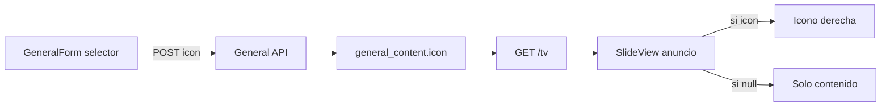

# Banco de iconos — Información General (TV)

**Fecha:** 2026-07-14  
**Enfoque elegido:** A — campo `icon` + banco Lucide fijo  
**Ámbito:** panel `/admin/general`, API general/TV, layout `anuncio` en cartelera

## Objetivo

Permitir elegir un icono del banco al configurar cada contenido de Información General, y mostrarlo en la TV a la derecha del slide (zona marcada en el boceto), sin alterar el flujo de media/afiche existente.

## Decisiones de producto

| Tema | Decisión |
|------|----------|
| Asociación | Un icono **por cada contenido** (no por categoría) |
| Origen | **Banco fijo Lucide** (~12–20 claves), sin subida de archivo |
| Sin icono | **No mostrar** el slot derecho (layout como hoy) |
| Alcance TV | Layout **anuncio** del escenario `general` (incluye divisas y demás con/sin `external`) |
| Admin listado | Miniatura del icono elegido junto al ítem |
| Obligatorio | No; valor `NULL` / vacío = sin icono |

## Fuera de alcance

- Subir PNG/SVG personalizados
- Tabla CRUD de iconos
- Icono por categoría como entidad configurada
- Cambiar layouts `afiche` o `evento`
- Defaults automáticos por categoría en TV

## Modelo de datos

Columna nueva en `general_content`:

```sql
ALTER TABLE general_content
  ADD COLUMN icon VARCHAR(50) NULL;

COMMENT ON COLUMN general_content.icon IS
  'Clave Lucide del banco (ej. dollar-sign). NULL = sin icono en TV.';
```

- Actualizar también [`sql/schema.sql`](../../sql/schema.sql) para instalaciones nuevas.
- Validación: solo claves del banco permitido; vacío → `NULL`.
- `upsertExternal` / cron **no** asignan icono (quedan `NULL` hasta edición manual).

## Banco de iconos (frontend)

Catálogo compartido, p. ej. `frontend/src/lib/tv/generalIcons.ts`:

- Lista de `{ key, label }` con nombres Lucide-svelte existentes (p. ej. `dollar-sign`, `cloud`, `newspaper`, `calendar`, `building-2`, `megaphone`, `trophy`, `droplets`, `landmark`, `trending-up`, `bell`, `info`).
- Mapa `key → componente Lucide` para render admin y TV.
- Opción UI **“Ninguno”** que persiste `icon` vacío/`NULL`.

## API

### Escritura (`GeneralController` + `GeneralContent`)

- Incluir `icon` en create/update vía FormData (mismo patrón que el resto de campos).
- En `normalizeData`: string vacío → `NULL`; rechazar o ignorar claves fuera del banco (whitelist en PHP o confiar en whitelist frontend + check en controller).

### Lectura TV (`TvController`)

Añadir al payload de cada slide `general`:

```php
'icon' => $g['icon'] ?: null,
```

### Tipos frontend

Extender el tipo de slide en `frontend/src/lib/tv/types.ts` (o equivalente) con `icon?: string | null`.

## UI Admin

### Formulario — [`GeneralForm.svelte`](../../frontend/src/lib/components/crud/GeneralForm.svelte)

- Campo nuevo “Icono para la TV” debajo de categoría/título (o tras media).
- Grid de iconos del banco; el seleccionado con borde de marca.
- Celda “Ninguno”.
- `form.icon` en el estado; se envía en el `FormData` al guardar.

### Listado — [`admin/general/+page.svelte`](../../frontend/src/routes/admin/general/+page.svelte)

- Mostrar el icono Lucide (tamaño pequeño) junto a categoría o título cuando `item.icon` exista.

## UI TV — [`SlideView.svelte`](../../frontend/src/lib/components/ui/SlideView.svelte) + [`tv.css`](../../frontend/src/lib/tv.css)

Layout `anuncio` (rama `else` actual):

```
.tv-slide
  .tv-slide-body-row          (flex/grid: main | visual)
    .tv-slide-main            (badge, título, descripción, métricas — actual)
    .tv-slide-visual          (solo si slide.icon) — icono Lucide grande
```

- El visual ocupa la zona derecha del boceto (~cuadrado grande, centrado verticalmente).
- Color: blanco / `currentColor` sobre fondo `var(--tv-color-header)`; opcional fondo semitransparente.
- Si `!slide.icon`, no renderizar `.tv-slide-visual` (sin hueco vacío forzado).
- No usar `image_path` como icono.

## Flujo



## Criterios de aceptación

1. Al crear/editar un ítem general se puede elegir un icono del banco o “Ninguno”.
2. El valor se persiste y reaparece al volver a editar.
3. En `/tv`, slides `general` con `icon` muestran el Lucide a la derecha en layout anuncio.
4. Slides sin `icon` se ven como antes (sin hueco vacío a la derecha).
5. Indicadores externos del cron siguen funcionando; icono opcional vía Editar.
6. Claves inválidas no se guardan (o se normalizan a `NULL`).

## Archivos principales a tocar

| Archivo | Cambio |
|---------|--------|
| `sql/schema.sql` + migración/`ALTER` | Columna `icon` |
| `src/Models/GeneralContent.php` | Normalizar `icon` |
| `src/Api/GeneralController.php` | Permitir campo |
| `src/Api/TvController.php` | Exponer `icon` |
| `frontend/src/lib/tv/generalIcons.ts` | Banco + mapa Lucide (nuevo) |
| `frontend/src/lib/components/crud/GeneralForm.svelte` | Selector |
| `frontend/src/routes/admin/general/+page.svelte` | Miniatura |
| `frontend/src/lib/components/ui/SlideView.svelte` | Slot derecho |
| `frontend/src/lib/tv.css` | Estilos fila + visual |
| `frontend/src/lib/tv/types.ts` | Tipo `icon` |
